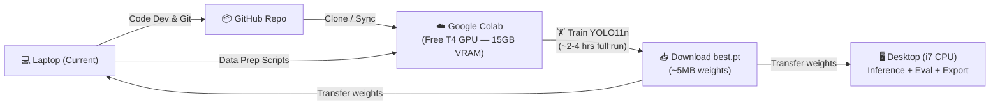

# Deep Learning Model for Microbiology Laboratory Image Analysis (ADLMS)

Build and train a YOLO11n-based deep learning model for automated analysis of microbiology agar plate images — covering colony detection/counting, inhibition zone measurement, and negative plate screening.

---

## References Extracted from Poyecto.md

### YOLO Repository

| Reference | Source | Use Case |
|---|---|---|
| **Ultralytics YOLO11n** | `pip install ultralytics` / [GitHub](https://github.com/ultralytics/ultralytics) | Core detection model for inhibition zones & colony localization |
| **Ciftci et al. (2026)** | [DOI: 10.3389/fmicb.2026.1810754](https://doi.org/10.3389/fmicb.2026.1810754) | Reference architecture — YOLO11n for AST zone detection (CA: 94.2%, MAE: 0.42mm) |
| **Bellundagi et al. (2026)** | [Zenodo: 21237433](https://zenodo.org/records/21237433) | YOLO-based colony counting with Tkinter GUI — reference code & AGAR_demo dataset |

### Image Bank / Datasets

| Dataset | Content | Format | Access |
|---|---|---|---|
| **AGAR** (Annotated Germs for Automated Recognition) | 18,000 images, 336,442 labeled colonies, 5 microbial species | COCO bounding boxes | [agar.neurosys.com](https://agar.neurosys.com/) / [OpenDataLab](https://opendatalab.com/) |
| **Zenodo AGAR_demo** | Subset used in Bellundagi et al. | JSON → YOLO format | [Zenodo 21237433](https://zenodo.org/records/21237433) |
| **MicrobIA** | Haemolysis classification + segmentation masks | Varied | [GitHub](https://github.com/majsylw/microbial-counting-review) |

### Additional Key References from the Document

- **U-Net** — Semantic segmentation of bacterial colonies ([Line 67](file:///media/mel12n/Datos/git/ADLMS/Poyecto.md#L67))
- **Cao et al. (2024)** — U2-Net + ResNet50 colony counting pipeline ([Line 150](file:///media/mel12n/Datos/git/ADLMS/Poyecto.md#L150))
- **Grad-CAM (XAI)** — Post-hoc explainability for clinical trust ([Lines 70, 89](file:///media/mel12n/Datos/git/ADLMS/Poyecto.md#L70))
- **TensorFlow Lite / ONNX Runtime Mobile** — Edge AI model export ([Lines 67, 133](file:///media/mel12n/Datos/git/ADLMS/Poyecto.md#L67))

---

## Hardware Analysis (Resolved)

### Machine Inventory

| Spec | 💻 Laptop (Current — Linux) | 🖥️ Desktop (Home) |
|---|---|---|
| **Model** | Sony VAIO VPCEG33FL | Custom build |
| **CPU** | Intel Core i5-2450M (2.5GHz, 2C/4T) | Intel Core i7 10th gen (8C/16T) |
| **GPU** | NVIDIA GeForce 410M (1GB) | AMD Radeon RX 6600 (8GB) |
| **CUDA CC** | 2.1 (Fermi) | N/A (AMD) |
| **RAM** | 4-8 GB DDR3 | ~16-32 GB DDR4 |
| **DL Training** | ❌ **Unusable** — CC 2.1 is far below PyTorch minimum (5.0+) | ❌ **No CUDA** — ROCm not officially supported for RX 6600 |
| **CPU Training** | ❌ Too slow (2C/4T, old arch) | ✅ Viable for YOLO11n nano (8C/16T) |
| **Best Role** | 🔧 Code development, git, data prep scripts | 🏋️ CPU training (fallback), inference, preprocessing |

> [!CAUTION]
> **Laptop GPU (GeForce 410M)**: CUDA Compute Capability 2.1 (Fermi, ~2011). Modern PyTorch requires CC ≥ 5.0 minimum. This GPU **cannot** run any modern deep learning framework.

> [!WARNING]
> **Desktop GPU (RX 6600)**: AMD RDNA 2 (gfx1032). Not on ROCm's official support list. The `HSA_OVERRIDE_GFX_VERSION` workaround exists but is unstable and not recommended for production training.

### Recommended Training Strategy



| Priority | Environment | Tasks | Cost |
|---|---|---|---|
| 🥇 **Primary** | **Google Colab** (Free T4 GPU, 15GB VRAM) | Full YOLO11n training, hyperparameter tuning, cross-validation | Free |
| 🥈 **Secondary** | **Desktop i7 10th gen** (CPU) | Quick prototype runs (5-10 epochs), evaluation, Grad-CAM, TFLite/ONNX export | Free |
| 🔧 **Development** | **Laptop** (current, Linux) | Code writing, data pipeline scripts, git management, unit tests | Free |

> [!TIP]
> **Google Colab Workflow**: Mount Google Drive → upload AGAR dataset once → train with free T4 GPU → download `best.pt` weights (~5MB). The YOLO11n nano model trains fast — expect ~2-4 hours for 100 epochs on Colab's T4.

---

## Open Questions

> [!IMPORTANT]
> **Dataset Download Strategy**: The AGAR dataset is ~18,000 images (several GB). Should we:
> - **(A)** Download the full AGAR dataset for comprehensive training?
> - **(B)** Start with the smaller **AGAR_demo** subset from Zenodo for rapid prototyping, then scale up?

> [!IMPORTANT]
> **Primary Task Priority**: Poyecto.md describes three distinct vision tasks. Which should we tackle first?
> 1. **Negative plate screening** (binary: growth vs. no growth) — simplest, highest impact (84-88% of plates)
> 2. **Colony detection & counting** (object detection with YOLO11n) — core task
> 3. **Inhibition zone measurement** (AST/antibiogram regression) — most complex, requires zone diameter in mm

> [!IMPORTANT]
> **Model Scope**: Should we build a single unified model or separate specialized models for each task?

---

## Proposed Changes

### Phase 1 — Project Scaffolding & Environment

#### [NEW] [requirements.txt](file:///media/mel12n/Datos/git/ADLMS/requirements.txt)
Core Python dependencies:
```
ultralytics>=8.3.0       # YOLO11n
torch>=2.0               # PyTorch backend
torchvision>=0.15
opencv-python>=4.8       # Image preprocessing (OpenCV)
albumentations>=1.3      # Data augmentation
matplotlib>=3.7          # Visualization
seaborn>=0.12            # Metrics plots
grad-cam>=1.5            # Grad-CAM XAI
onnx>=1.14               # ONNX export
onnxruntime>=1.16         # ONNX inference
tflite-support>=0.4      # TFLite conversion
scikit-learn>=1.3        # Metrics (confusion matrix, etc.)
pandas>=2.0              # Data handling
pyyaml>=6.0              # YOLO config files
```

#### [NEW] Project directory structure
```
ADLMS/
├── .antigravity/
│   └── implementation_plan.md  # Saved implementation plan
├── data/
│   ├── raw/                    # Original AGAR images (downloaded)
│   ├── processed/              # Cleaned, resized, normalized images
│   ├── annotations/            # YOLO-format labels (.txt)
│   └── splits/                 # train/val/test splits
│       ├── train/
│       │   ├── images/
│       │   └── labels/
│       ├── val/
│       │   ├── images/
│       │   └── labels/
│       └── test/
│           ├── images/
│           └── labels/
├── configs/
│   └── dataset.yaml            # YOLO dataset configuration
├── src/
│   ├── data/
│   │   ├── download_agar.py    # Script to download AGAR dataset
│   │   ├── coco_to_yolo.py     # COCO→YOLO annotation converter
│   │   ├── preprocess.py       # OpenCV preprocessing pipeline
│   │   └── augment.py          # Data augmentation pipeline
│   ├── models/
│   │   ├── train_yolo.py       # YOLO11n training script
│   │   ├── train_unet.py       # U-Net segmentation (future)
│   │   └── export_model.py     # TFLite/ONNX export
│   ├── evaluation/
│   │   ├── evaluate.py         # Metrics: mAP, Recall, Precision, F1
│   │   └── grad_cam.py         # Grad-CAM explainability
│   └── utils/
│       ├── visualization.py    # Plot results, bounding boxes
│       └── constants.py        # Project-wide constants
├── notebooks/
│   └── 01_eda.ipynb            # Exploratory Data Analysis
├── models/                     # Saved model weights
│   ├── checkpoints/
│   └── exports/                # TFLite, ONNX exported models
├── results/                    # Training logs, plots, metrics
├── requirements.txt
├── build_code_map.py           # AG-SKILL-06 graph maintenance
├── codebase_map.json           # AG-SKILL-06 dependency graph
└── Poyecto.md                  # (existing)
```

---

### Phase 2 — Data Pipeline

#### [NEW] [download_agar.py](file:///media/mel12n/Datos/git/ADLMS/src/data/download_agar.py)
- Download AGAR dataset from neurosys.com or OpenDataLab
- Validate checksums and directory structure
- Download Zenodo AGAR_demo subset as fallback/prototype option

#### [NEW] [coco_to_yolo.py](file:///media/mel12n/Datos/git/ADLMS/src/data/coco_to_yolo.py)
- Convert AGAR's COCO JSON annotations to YOLO format (one `.txt` per image)
- Map AGAR categories → YOLO class IDs
- Handle `countable`, `uncountable`, `empty` classification

#### [NEW] [preprocess.py](file:///media/mel12n/Datos/git/ADLMS/src/data/preprocess.py)
- OpenCV-based preprocessing pipeline per Poyecto.md requirements:
  - Histogram normalization (CLAHE) for lighting variance
  - Affine transformations for geometric correction
  - Resize to YOLO input dimensions (640×640)
  - Data drift mitigation for heterogeneous camera sensors

#### [NEW] [augment.py](file:///media/mel12n/Datos/git/ADLMS/src/data/augment.py)
- Albumentations pipeline: rotation, flip, brightness/contrast, blur, color jitter
- SAM-based synthetic colony paste augmentation (advanced, optional)

#### [NEW] [dataset.yaml](file:///media/mel12n/Datos/git/ADLMS/configs/dataset.yaml)
```yaml
# YOLO Dataset Configuration for AGAR Microbiology
path: ../data/splits
train: train/images
val: val/images
test: test/images

names:
  0: colony          # Bacterial colony
  1: inhibition_zone # AST inhibition halo
  2: antibiotic_disk # Antibiotic disk
  3: empty_plate     # No growth
```

---

### Phase 3 — Model Training (YOLO11n)

Training is designed for **two environments** based on the hardware analysis:

#### [NEW] [train_yolo.py](file:///media/mel12n/Datos/git/ADLMS/src/models/train_yolo.py)
Core training script (works on both Colab GPU and Desktop CPU):
```python
from ultralytics import YOLO
import torch

# Auto-detect device: Colab GPU → Desktop CPU fallback
device = 0 if torch.cuda.is_available() else 'cpu'

# Load pretrained YOLO11n (nano — lightweight for Edge AI)
model = YOLO("yolo11n.pt")

# Train on AGAR microbiology dataset
results = model.train(
    data="configs/dataset.yaml",
    epochs=100,
    imgsz=640,
    batch=16 if device == 0 else 8,  # Smaller batch on CPU
    device=device,
    patience=20,       # Early stopping
    save=True,
    project="results",
    name="yolo11n_microbiology",
    workers=4 if device == 'cpu' else 8,
)
```

#### [NEW] [train_colab.ipynb](file:///media/mel12n/Datos/git/ADLMS/notebooks/train_colab.ipynb)
Google Colab notebook for GPU training:
- Mount Google Drive for dataset persistence
- Install `ultralytics` in Colab runtime
- Train with T4 GPU (batch=16, ~2-4 hours for 100 epochs)
- Auto-save `best.pt` weights to Drive for download
- Includes Grad-CAM visualization cells

#### Training Environment Matrix

| Parameter | ☁️ Colab (T4 GPU) | 🖥️ Desktop (i7 CPU) |
|---|---|---|
| `device` | `0` (auto-detect CUDA) | `'cpu'` |
| `batch` | 16 | 8 |
| `epochs` | 100 | 10-20 (prototype only) |
| `imgsz` | 640 | 640 |
| `workers` | 8 | 4 |
| Est. time (100 epochs) | ~2-4 hours | ~12-24 hours |

Key training decisions from Poyecto.md:
- **Maximize Recall (Sensitivity)** over Precision → prioritize detecting all colonies/zones, minimize false negatives
- **Cross-validation**: k-fold for robust evaluation
- **Transfer learning**: Start from COCO-pretrained YOLO11n weights
- **Target metrics** (per Ciftci et al.): CA ≥ 94%, VME ≤ 1.2%

---

### Phase 4 — Evaluation & Metrics

#### [NEW] [evaluate.py](file:///media/mel12n/Datos/git/ADLMS/src/evaluation/evaluate.py)
- **mAP@0.5** and **mAP@0.5:0.95** — standard object detection metrics
- **Sensitivity (Recall) > 90%** — primary metric per Poyecto.md clinical requirements
- **Confusion matrix** — per class performance
- **Categorical Agreement (CA)** — for AST interpretation alignment
- **MAE (Mean Absolute Error)** — for zone diameter regression in mm

#### [NEW] [grad_cam.py](file:///media/mel12n/Datos/git/ADLMS/src/evaluation/grad_cam.py)
- Implement Grad-CAM post-hoc XAI visualization per Poyecto.md §IV.b
- Overlay translucent heatmaps on input images
- Validate model focuses on biologically relevant features (zone boundaries, colony morphology)

---

### Phase 5 — Edge AI Export

#### [NEW] [export_model.py](file:///media/mel12n/Datos/git/ADLMS/src/models/export_model.py)
- Export trained YOLO11n to:
  - **TensorFlow Lite** (INT8 quantized) — >75% size reduction per Poyecto.md
  - **ONNX Runtime Mobile** — cross-platform inference
- Benchmark inference speed on CPU (target: sub-second)
- Validate accuracy preservation post-quantization

---

### Phase 6 — Codebase Graph (AG-SKILL-06 Compliance)

#### [NEW] [build_code_map.py](file:///media/mel12n/Datos/git/ADLMS/build_code_map.py)
- Generate `codebase_map.json` with module imports and dependency graph
- Enable token-optimized context retrieval for future development

#### [NEW] [codebase_map.json](file:///media/mel12n/Datos/git/ADLMS/codebase_map.json)
- Auto-generated dependency graph of all Python modules

---

## Verification Plan

### Automated Tests
```bash
# Verify environment setup
pip install -r requirements.txt
python -c "from ultralytics import YOLO; print('YOLO OK')"
python -c "import cv2; print('OpenCV OK')"

# Verify data pipeline
python src/data/coco_to_yolo.py --input data/raw --output data/splits --verify

# Run training (short validation run)
python src/models/train_yolo.py --epochs 5 --batch 8

# Evaluate model
python src/evaluation/evaluate.py --model results/yolo11n_microbiology/weights/best.pt

# Export to TFLite
python src/models/export_model.py --format tflite --quantize int8

# Update codebase map (AG-SKILL-06)
python build_code_map.py
```

### Manual Verification
- Visual inspection of Grad-CAM heatmaps on sample plates
- Verify YOLO detections overlay correctly on agar plate images
- Confirm exported TFLite model runs inference < 1 second on CPU
- Cross-reference detection accuracy against Ciftci et al. benchmarks (CA ≥ 94%)
