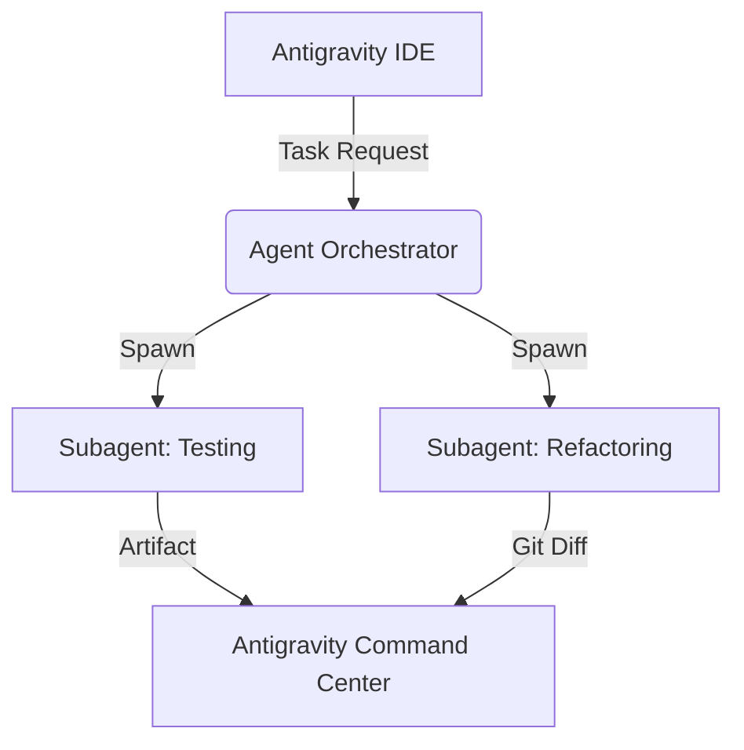

# Google Antigravity Skill Definitions (`SKILLS.md`)
>
> **Version:** 2.0  
> **Target Environment:** Google Antigravity IDE / Antigravity CLI / Antigravity SDK  
> **Agent Engine:** Gemini 3.5 / Agentic Harness  

---

## Overview

This repository document defines the operational skills, workflows, and guardrails for autonomous agents executing within the **Google Antigravity** platform. Antigravity agents use these definitions to understand role boundaries, execution steps, tool usage, and verification protocols across workspace tasks.

---

## 1. Core Agent Capabilities

| Skill ID | Skill Name | Primary Tools | Trigger Keywords |
| :--- | :--- | :--- | :--- |
| `AG-SKILL-01` | **Code Base Refactoring & Modernization** | Antigravity IDE, AST Parsers, Linter | `refactor`, `clean code`, `optimize`, `modernize` |
| `AG-SKILL-02` | **Automated Test & Artifact Generation** | Antigravity Harness, Browser-in-the-Loop, PyTest | `generate tests`, `verify build`, `create artifact` |
| `AG-SKILL-03` | **Autonomous CLI & Subagent Orchestration** | Antigravity CLI, Background Workers | `run parallel`, `spawn subagent`, `batch execute` |
| `AG-SKILL-04` | **Root Cause Analysis & Debugging Loop** | Terminal Logs, Stack Trace Analyzer | `debug`, `fix issue`, `investigate crash`, `fix error` |
| `AG-SKILL-05` | **Architecture Mapping & ADR Documentation** | Codebase Graph, Workspace Inspector | `document architecture`, `generate adr`, `map system` |

---

## 2. Skill Specifications

### AG-SKILL-01: Code Base Refactoring & Modernization

#### Context & Objectives

Empowers the agent to perform multi-file refactoring without breaking existing behavior, enforcing style guidelines, type annotations, and design pattern improvements.

#### Execution Protocol

1. **Context Acquisition:** Load workspace AST and identify file dependencies across the project.
2. **Impact Analysis:** Run static analysis to detect all callers and imported references.
3. **Drafting Patch:** Generate non-destructive diffs in the working memory.
4. **Local Verification:** Run workspace linters and formatters prior to applying changes.
5. **Final Commit:** Apply changes and log structural modifications in the Antigravity task timeline.

```yaml
# Skill Configuration Snippet
skill:
  id: AG-SKILL-01
  autonomy_level: medium
  required_approvals:
    - breaking_changes: true
    - dependency_updates: true
  max_files_per_turn: 15
```

---

### AG-SKILL-02: Automated Test & Artifact Generation

#### Context & Objectives

Configures the agent to automatically write unit, integration, and end-to-end tests, generating structured Antigravity **Artifacts** to prove code correctness.

#### Verification Pipeline

```
[ Code Change ] ➔ [ Parse AST ] ➔ [ Draft Test Suite ] ➔ [ Run in Sandbox ] ➔ [ Generate Artifact Report ]
```

#### Guidelines

- Every newly created function must have at least one happy-path unit test and one edge-case/boundary test.
- Use **Browser-in-the-Loop** verification for frontend UI components.
- Output artifacts using structured JSON/Markdown reports saved to `.antigravity/artifacts/`.

---

### AG-SKILL-03: Autonomous CLI & Subagent Orchestration

#### Context & Objectives

Allows a primary agent in Antigravity IDE or CLI to delegate scoped sub-tasks (e.g., dependency audit, asset compression, parallel test execution) to background subagents.

#### CLI Command Examples

```bash
# Spawning a background subagent for code linting
antigravity agent spawn --skill=AG-SKILL-01 --task="Lint all python files in src/"

# Orchestrating parallel workspace tasks
antigravity subagent run-parallel \
  --task-1="pytest tests/unit" \
  --task-2="npm run lint" \
  --task-3="antigravity verify-build"
```

#### Guardrails

- Subagents must operate in isolated sandbox workspaces.
- Main agent retains final veto power over git commits or destructive file writes.

---

### AG-SKILL-04: Root Cause Analysis & Debugging Loop

#### Context & Objectives

Provides systematic step-by-step debugging when terminal commands or test suites fail.

#### Iterative Loop

1. **Capture Error:** Read stdout/stderr logs from Antigravity Terminal.
2. **Isolate Scope:** Determine if error stems from syntax, runtime, environment variables, or third-party APIs.
3. **Formulate Hypothesis:** Test hypothesis using minimal code reproduction scripts via Antigravity SDK.
4. **Apply Patch:** Refactor minimal viable code block.
5. **Regression Check:** Rerun entire module test suite to ensure zero regressions.

---

### AG-SKILL-05: Architecture Mapping & ADR Documentation

#### Context & Objectives

Automatically generates Architectural Decision Records (ADRs), system flow diagrams (Mermaid format), and API documentations based on actual codebase state.

#### Output Example (Mermaid Diagram)



---

### AG-SKILL-06: Token-Optimized Context Retrieval

#### Context & Objectives

Minimizes token consumption by enforcing graph-based file selection before reading source code.

#### Execution Protocol (MANDATORY)

1. **Graph-First Lookup:** When assigned a task, open ONLY `codebase_map.json`.
2. **Dependency Tracing:** Identify the exact target file and trace its direct `imports` and `imported_by` array.
3. **Selective Reading:** Load ONLY the files identified in Step 2 into context. DO NOT read the rest of the workspace or scan directories.
4. **Graph Maintenance:** If you create, delete, or modify imports in any file, run `python build_code_map.py` at the end of your task to keep the graph updated.

---

### AG-SKILL-07: Discord Rate Limit & Resiliency Audit

#### Context & Objectives

Scans and refactors the codebase specifically to prevent HTTP 429 errors, Cloudflare IP bans, and unthrottled API bottlenecks, enforcing compliance with official Discord API boundaries.

#### Trigger Keywords

`audit rate limits`, `check 429`, `discord concurrency`, `fix rate limits`, `discord limits`

#### Reference Specification

- **Primary Authority:** `DISCORD_RATE_LIMITS.md` (Must be consulted for bucket thresholds, HTTP headers, and code pattern templates).

#### Execution Protocol

1. **Target Identification (Token-Optimized):**
   - Query `codebase_map.json` to locate all files importing Discord API wrappers (`discord.py`, `nextcord`, etc.), webhooks, REST helpers, or background tasks (`@tasks.loop`).
2. **Inspection Criteria:**
   - **Error Handling:** Verify that all REST requests handle `discord.errors.HTTPException` with status 429 and dynamically await `retry_after` / `X-RateLimit-Reset-After`.
   - **Concurrency Control:** Ensure bulk actions (channel, thread, or role creation/deletion) use bounded concurrency (`asyncio.Semaphore`) as specified in `DISCORD_RATE_LIMITS.md`.
   - **Async Integrity:** Verify no synchronous blocking calls (`time.sleep`) exist in async loops. Ensure `asyncio.gather` uses `return_exceptions=True` for batch tasks.
   - **Interactions:** Ensure slash command or interaction callbacks respond or call `defer()` within 2.5 seconds.
3. **Artifact Creation:**
   - Generate an audit report at `.antigravity/artifacts/audit_rate_limits.md` with file citations, line numbers, severity levels (High/Medium/Low), and proposed code diffs using patterns from `DISCORD_RATE_LIMITS.md`.

---

### AG-SKILL-08: Automated Project Documentation & Maintenance

#### Context & Objectives

Scans the codebase and `codebase_map.json` to autonomously generate, update, and maintain comprehensive, structured project documentation (including `README.md`, `ARCHITECTURE.md`, module guides, and command/API specifications).

#### Trigger Keywords

`generate docs`, `update documentation`, `document project`, `create api docs`, `update readme`

#### Execution Protocol

1. **Context & Dependency Mapping (Token-Optimized):**
   - Consult `codebase_map.json` to analyze the repository structure, entry points (`main.py`, cogs), data models, and utility modules without scanning untracked directories.
   - Inspect existing documentation files to preserve custom notes, credentials warnings, or specific developer guidelines.
2. **Documentation Scope & Standards:**
   - **Root README (`README.md`):** High-level overview, feature summary, environment setup (`.env` template), dependencies, and quickstart commands.
   - **Architecture Overview (`docs/ARCHITECTURE.md`):** Component breakdown, cog relationships, database flow, and event execution loops (using Mermaid.js diagrams where applicable).
   - **Cog & Feature Specs (`docs/modules/`):** Command lists, parameter definitions, required permissions, rate limit guards, and usage examples.
3. **Quality & Veracity Enforcement:**
   - Ensure all documented bot commands, parameters, and configuration options strictly match actual source code signatures.
   - Include type hints, default values, and error-handling explanations for public utility functions and core classes.
4. **Artifact Synchronization:**
   - Write or update documentation files in the target directories (`docs/` or project root).
   - Output a summary of created/updated documentation at `.antigravity/artifacts/documentation_update_summary.md`.
   - Run `python build_code_map.py` if new documentation scripts or directory structures were introduced.

---

### AG-SKILL-09: GSD (Get Stuff Done) Multi-Agent Orchestrator

#### Context & Objectives

Orchestrates a virtual 5-role software engineering team to execute complex, multi-file refactoring or feature implementation with strict context isolation, peer code review, and automated documentation.

#### Virtual Team Roles & Responsibilities

1. **Team Lead (Orchestrator):** Manages `codebase_map.json`, breaks tasks into sub-tasks, delegates to specialists, and produces final integration reports.
2. **Backend & Logic Specialist:** Handles core Python logic, database queries (`database.py`/Supabase), async pipelines, and cog commands.
3. **Frontend & UI Specialist:** Manages Discord interfaces (`discord.ui.View`, Modals, Buttons, Embeds, formatting).
4. **QA & Code Reviewer (Adversarial):** Audits code against `DISCORD_RATE_LIMITS.md`, tests exception handling, checks for memory/async leaks, and verifies execution via CLI.
5. **Writer & Docs Specialist:** Keeps `README.md`, `codebase_map.json`, and architecture diagrams continuously in sync.

---

#### Execution Protocol

1. **Delegation Phase:** Team Lead assigns isolated tasks using targeted token lookup (`AG-SKILL-07`).
2. **Peer Review Loop:** Logic and UI changes MUST be audited by the QA Specialist against strict guardrails before integration.
3. **Self-Correction:** If QA rejects a change, the offending specialist must patch the issue autonomously (up to 3 retries).
4. **Clean Merge:** Only clean, verified code and updated documentation are committed to the repository graph.

## 3. Global Guardrails & Rules

1. **Explicit Consent for Destructive Actions:** Deleting databases, running `rm -rf`, or overwriting uncommitted git changes requires explicit user confirmation.
2. **No Hallucinated Imports:** Only use packages present in `requirements.txt`, `package.json`, or official standard libraries unless installation is explicitly requested.
3. **Artifact Consistency:** Always pair complex tasks with an Antigravity Artifact summary detailing modified files, test outputs, and pending recommendations.

---

*Generated for Google Antigravity Workspaces.*
